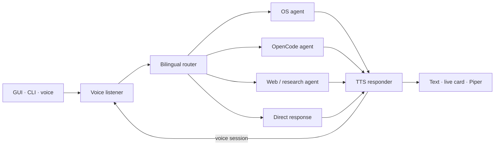

<div align="center">

# MERLIN

### Your local assistant for voice, desktop automation, and research

Speak or type in Spanish or English. MERLIN recognizes your intent, routes the
request to a focused agent, and responds with local models in text or speech.

**Python · LangGraph · Ollama · faster-whisper · Piper · CustomTkinter**

</div>

---

## What MERLIN can do

| Area | Current capabilities |
| --- | --- |
| **Voice** | Wake-word activation, silence-based recording, Spanish/English transcription, and spoken responses. |
| **Desktop** | Launch apps, interact with windows, inspect system resources, manage files, and write/verify text in Word. |
| **Research** | Search the web and ArXiv, retrieve content, and summarize findings. |
| **Productivity** | Prepare OpenCode prompts, control media, share files in WhatsApp chats, and stage image posts/stories for LinkedIn, Facebook, and WhatsApp Web. |
| **Interface** | GUI, terminal mode, and a floating results card that displays responses while they are generated and spoken. |

Automation depends on the operating system and installed applications. MERLIN
can capture screenshots, but it does not yet interpret images or camera input.
Social composers are staged for review and require explicit confirmation before
publishing. Their browser UI and login sessions must be available.

## Architecture



LangGraph organizes the workflow. Ollama serves local models through a lightweight
`httpx` connection. The router uses bilingual rules for common requests; the
optional LLM classifier is enabled with `MERLIN_ROUTER_LLM=1`. Chat history and
execution logs are stored locally as JSON.

## Requirements

- Windows has the broadest desktop automation coverage.
- Python 3.11 or later.
- Ollama running with the configured model installed.
- A microphone and audio output for voice interaction.
- Word or another supported application for writing workflows.

The first run may download Whisper and Piper voices. Web search, ArXiv, and
browser automation require an Internet connection.

## Quick start on Windows

In PowerShell, from the project directory:

```powershell
py -3.11 -m venv .venv
.\.venv\Scripts\Activate.ps1
python -m pip install --upgrade pip
python -m pip install -r requirements.txt
Copy-Item .env.example .env
```

Start Ollama and install the model configured by `MERLIN_MODEL` in `.env`. For
the example configuration:

```powershell
ollama pull qwen2.5-coder:3b
python main.py --check
```

If you configured a different model, download that model instead. Do not share
`.env`; it may contain private configuration.

## Run MERLIN

```powershell
python main.py              # GUI
python main.py --cli        # terminal conversation
python main.py --check      # check Ollama and the configured model
```

In the GUI, type a request or use the microphone. Hands-free mode listens for
the `jarvis` wake word by default. The floating card starts displaying text
when the first response fragments arrive and updates as generation continues.

## Configuration

`merlin/config.py` loads environment variables from `.env` in the project root.
Key options:

| Variable | Purpose | Example |
| --- | --- | --- |
| `OLLAMA_HOST` | Ollama server URL | `http://localhost:11434` |
| `MERLIN_MODEL` | Main model | `qwen2.5-coder:3b` |
| `MERLIN_FAST_MODEL` | Fast-profile model | `qwen2.5-coder:3b` |
| `MERLIN_WHISPER_SIZE` | Whisper model size | `small` |
| `MERLIN_STT_LANGUAGE` | STT language: `es`, `en`, or `auto` | `es` |
| `MERLIN_ROUTER_LLM` | Use LLM classification when no rule matches | `0` |
| `MERLIN_SELF_IMPROVEMENT` | Optional startup prompt maintenance | `0` |

Spanish is the default STT language. `auto` compares English and Spanish when
language detection is uncertain. You can also explicitly switch languages
during a voice session.

## Attachments and social sharing

- WhatsApp supports sharing an existing file path or the latest MERLIN
  screenshot in a chat. The current Windows workflow uses the system clipboard.
- WhatsApp Web can stage image status updates; Facebook can stage image stories
  and feed posts. These browser workflows depend on the logged-in site UI.
- LinkedIn can stage a post with an image in its browser composer. Review the
  visible draft and explicitly confirm before it is published.
- File sharing and publishing depend on the target app, its login session, and
  the file types accepted by that platform. Instagram publishing is not
  implemented.
- MERLIN can capture a screenshot, but screenshot capture is not visual
  understanding. It does not analyze screenshot contents.

## Safety and privacy

- Chat history and logs are stored locally.
- Voice recording, transcription, and speech synthesis run locally; web search
  and integrations access external services.
- Messaging, calls, and publishing use agent confirmation flows. Review the
  recipient, attachment, and draft before confirming an external action.
- Terminal commands have a minimal destructive-command blocklist. MERLIN can
  execute system commands, so review each request before confirming it.
- `.env`, logs, screenshots, chat history, and debug audio are private data;
  do not commit or upload them.

## Offline checks

With the virtual environment active, run these from the project root:

```powershell
python scripts/test_voice_word_routing.py
python scripts/test_voice_stt.py
python scripts/test_voice_endpoint.py
python scripts/test_voice_tts_queue.py
python scripts/test_voice_safety.py
python scripts/test_writing_tools.py
python scripts/test_streaming_results.py
python scripts/test_cleanup_regressions.py
python scripts/test_attachments.py
```

Some checks simulate Windows, Word, clipboard, and audio behavior. Mocked
results do not replace a manual check with a microphone and real applications.

## Project layout

```text
main.py                  GUI, CLI, health check, and autostart entry points
merlin/agents/           Voice listener, router, agents, and TTS response
merlin/tools/            Voice, desktop, writing, web, and app integrations
merlin/gui/              Main interface, avatar, and floating results card
merlin/persistence/      Local JSON history and execution logs
merlin/prompts/          Base conversation prompt
scripts/                 Voice utilities, smoke checks, and regressions
installer/               Packaging and platform installers
```

## Project status

The source of truth is the current code: Ollama + `httpx`, LangGraph, and
specialized agents. Prompt maintenance is optional startup work outside the
graph. LM Studio and `langchain-openai` are not used. Visual understanding is
not implemented yet.
